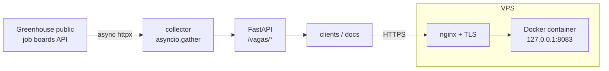

# AI Jobs Radar

[](https://github.com/Leandrosmoreira/ai-jobs-radar/actions/workflows/ci.yml)


**What does the market actually ask from an AI Engineer?** AI Jobs Radar collects job postings straight
from companies' public job boards and, step by step, turns them into a map of the skills that AI Engineer
roles really request. Today it collects every open position of a company; filtering AI roles and extracting
their requirements is the next step.

**Live API:** <https://radarjobs.leandrosmoreira.dev/docs>

> Status: **v0.1.0**. The collector and the API are live in production. LLM-based requirement extraction,
> MCP tools, RAG and the agent are on the [roadmap](#roadmap). This README only describes what the code does today.

## What it does today

| Endpoint | What it returns |
|---|---|
| `GET /health` | Liveness probe used by Docker and CI |
| `GET /vagas/greenhouse/{company}` | Open positions of one company on Greenhouse: total and the first 10 titles |
| `GET /vagas/contagem?empresas=a&empresas=b` | Open positions per company, fetched **concurrently** (up to 10), plus how long it took |

```bash
curl https://radarjobs.leandrosmoreira.dev/vagas/greenhouse/anthropic
curl "https://radarjobs.leandrosmoreira.dev/vagas/contagem?empresas=anthropic&empresas=airbnb&empresas=stripe"
```

Errors are explicit: an unknown company returns **404**; the job board being down or slow returns **502**
instead of a stack trace. In the concurrent count, an unknown company comes back as `-1` without cancelling the others.

## Architecture



- **Async collector** (`coletor.py`): fetching jobs is almost all network wait, so several companies are
  fetched at the same time with `asyncio.gather` instead of one after another.
- **Testable by design**: the HTTP client is injected as a FastAPI dependency, so tests swap it for a fake
  one — **no test hits the internet**.
- **Domain model** (`vaga.py`): a Pydantic v2 `Vaga` model (title, company, URL, remote, normalized
  requirements, seniority, dates) that validates external data before it enters the app. It is the target
  schema for the LLM extractor.

## Run locally

```bash
python -m venv .venv && source .venv/bin/activate   # Windows: .venv\Scripts\activate
pip install -e ".[dev]"
uvicorn ai_jobs_radar.main:app --reload
# open http://127.0.0.1:8000/docs
```

Or with Docker:

```bash
docker build -t ai-jobs-radar .
docker run --rm -p 8000:8000 ai-jobs-radar
```

## Tests and CI

```bash
pytest -v      # 20 tests: health check, collector (with a fake client) and the Vaga model
```

Every push to `main` runs [GitHub Actions](.github/workflows/ci.yml):

1. Tests on **Python 3.12 and 3.13**
2. Multi-stage **Docker build**, checked by starting the container and calling `/health`
3. Image published to **GitHub Container Registry** (`ghcr.io/leandrosmoreira/ai-jobs-radar`)
4. Optional phone notification via ntfy (topic stored in GitHub Secrets)

## Deploy

Runs on a shared VPS behind nginx with a Let's Encrypt certificate; the container only listens on
`127.0.0.1`, so Docker never exposes the port to the internet. Step by step (Caddy or nginx):
[docs/DEPLOY.md](docs/DEPLOY.md).

## Roadmap

| Step | What | Status |
|---|---|---|
| 1 | Package, API, `Vaga` model, tests, Docker, CI, deploy | ✅ done |
| 2 | **Extractor**: an LLM reads a job description and returns stack, seniority and type as JSON validated by `Vaga` | next |
| 3 | **MCP server**: collection (Greenhouse, Lever, Ashby) and extraction exposed as MCP tools | planned |
| 4 | **RAG**: jobs as embeddings in pgvector, hybrid search and re-ranking | planned |
| 5 | **Agent** (LangGraph) using the MCP tools and RAG, with guardrails and evals | planned |

## License

[MIT](LICENSE) © 2026 Leandro Moreira · [leandrosmoreira.dev](https://leandrosmoreira.dev)
